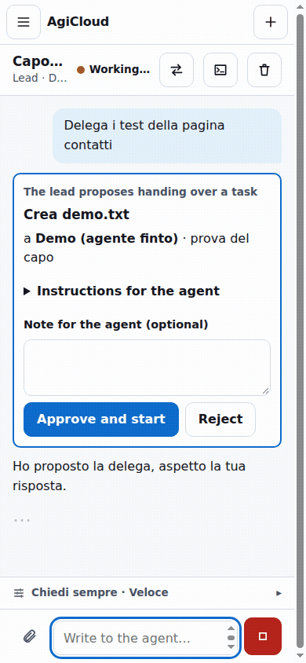

# AgiCloud

**All your AI coding agents in one cloud — even from your phone.**

AgiCloud is a web workspace for Claude Code, Codex, agy (Antigravity), Cursor and OpenCode. Chat with a "lead" agent that delegates tasks to other agents, each working in its own git worktree; you approve every delegation and choose what gets merged.

<p align="center"></p>

- Multi-agent chat with delegation, threads and merge/discard of changes
- Mobile-first UI with push notifications
- Terminal, file browser, Git, live shared Browser, Design studio
- PII anonymization plugin (runs locally, data stays on your server)
- Interface in Italian, English, German, Czech and Russian
- Built on open standards: ACP and AG-UI

**Hosted version:** [agicloud.dev](https://agicloud.dev) — ready in a minute, free 14-day trial, servers in the EU (Germany).
**Self-host:** see below. Licensed under [AGPL-3.0](LICENSE).

---

Interfaccia web multi-agente per agenti di coding (Claude Code, agy, Cursor, OpenCode, ...), basata sugli standard aperti **ACP** e **AG-UI**.

Stato: in uso quotidiano su app.agicloud.dev (Chat, Terminale, File, Design, Impostazioni, notifiche). Architettura in [docs/ARCHITECTURE.md](docs/ARCHITECTURE.md).

## Avvio

```bash
npm install
npm run build          # compila l'interfaccia web
npm start              # http://127.0.0.1:3095
```

Variabili: `PORT` (3095), `HOST` (127.0.0.1), `AUTH_TOKEN` (obbligatorio se HOST non è locale), `DATA_DIR` (`data`), `PROJECT_ROOTS` (`data/workspaces:/home/user:/opt:/var/www`), `IDLE_MINUTES` (30), `MAX_SESSIONS` (6), `AGICLOUD_DEMO_AGENT=1` (aggiunge l'agente finto per le prove), `TRUST_PROXY=1` (dietro reverse proxy).

Sviluppo dell'interfaccia: `npm start` in un terminale e `npm run dev -w @agicloud/web` nell'altro (Vite fa da proxy verso `/api`).

## Prova rapida del bridge

Richiede Node 22+ e almeno un agente installato e già loggato.

```bash
npm install
npm test
npm run probe -- opencode "Rispondi solo con: ciao"
npm run probe -- claude "Crea x.txt con dentro 'prova'" --allow
```

Prova dell'interfaccia (screenshot + axe, con l'agente demo): `scripts/ui-check/run.sh` (`--dark` per il tema scuro).

`probe` stampa gli eventi AG-UI prodotti dal bridge. Opzioni: `--cwd DIR` (cartella di lavoro, default una temporanea), `--allow` (approva i permessi, altrimenti li rifiuta), `--auth METODO` (login ACP, es. `oauth-personal`).
